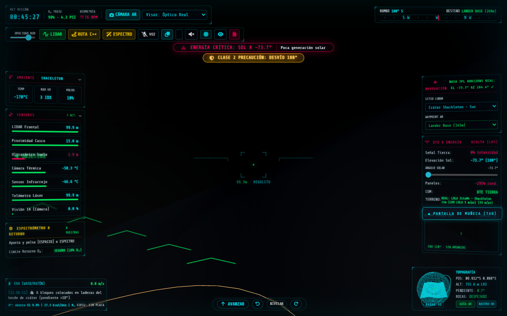
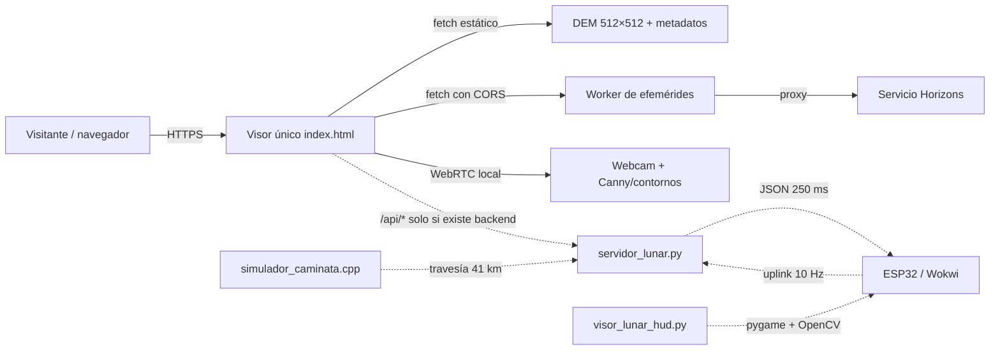

# StartRoot — Visor HUD de EVA lunar en primera persona

<p align="center">
  
</p>

<p align="center">
  <a href="https://gestion2026.online"></a>
  <a href="https://github.com/FerminGonzalez/startroot-lunar-hud"></a>
  
  
  
</p>

> **Un solo visor. Una sola decisión correcta en el campo de visión.**
> Caminata en primera persona sobre el relieve **real del cráter Shackleton** (polo sur lunar), con ruteo metabólico A*, visión artificial, efemérides astronómicas en vivo, sistema Caution & Warning y telemetría bidireccional con hardware físico simulable sin placa.

---

## TL;DR (EN)

A single-file, **browser-based first-person EVA helmet HUD** for lunar south-pole traverses. It renders a **real 5 m/px LOLA DEM** (Site04, Shackleton rim), computes an **A\* metabolic detour** around rocks and steep slopes with live O₂/kcal savings, overlays **Canny-based AR detection** from a webcam, asks a **live ephemeris service** for Sun azimuth and Earth occultation (switching comms to a relay when Earth sets), implements **Class 1/2/3 Caution & Warning + monochrome fail-safe**, and streams **bidirectional JSON telemetry** to an ESP32 (fully reproducible in Wokwi, no board required). **Open the link and walk — no install, no account.**

---

## 1. El problema

En una caminata extravehicular (EVA) en el polo sur lunar no hay GPS, el Sol permanece rasante, la Tierra entra y sale de la línea de visión, y cada desvío se paga en **oxígeno y energía metabólica**. Un panel con 40 números no ayuda: el astronauta necesita **la decisión ya proyectada sobre el terreno**, en su campo de visión, con degradación elegante cuando algo falla.

Tres restricciones que gobiernan el diseño:

| Restricción | Consecuencia de diseño |
|---|---|
| Baja elevación solar y sombras permanentes | Iluminación y efemérides **reales**, no decorativas |
| Enlace directo intermitente | Conmutación automática DTE ↔ relé, estado explícito en HUD |
| Consumo de O₂ y fatiga | Rutero que **cuesta** kcal, no solo distancia |

## 2. La solución — un visor, cinco capas de ingeniería

**`index.html`** es el producto: un único archivo autocontenido (Three.js r160 local, sin build, sin CDNs de lógica). Todo lo demás son herramientas de verificación, datos y hardware.

| # | Capacidad | Qué hace de verdad |
|---|---|---|
| 1 | **Ruteo A\* metabólico** | Grid local 21×15 (1,2 m/celda) con coste por pendiente >25° y rocas; A* 8-conectado con `heap`/montículo binario; corredor Bézier de **dos carriles con chevrons animados** que sigue el relieve; ahorro de O₂ y modelo `kcal/min = 6,0 + 0,9·\|pendiente\| + 2,0·v` en pantalla |
| 2 | **Visión artificial en vivo** | `getUserMedia` + Canny en JS puro (Sobel → NMS → histéresis 55/150) y contornos; cajas tácticas AR con distancia estimada; también en la app de escritorio con OpenCV |
| 3 | **Efemérides reales 89,9°S** | Sol (AZ/EL) y Tierra consultados en vivo; **EL < 0 ⇒ Tierra oculta ⇒ `COM: GATEWAY (relé)`** con aviso y registro; en estático pasa por un Worker propio con CORS |
| 4 | **C&W Clase 1/2/3 + Fail-Safe** | Clasificación por roca en trayectoria, batería <15% y radiación; tecla **M** o auto-trigger → HUD monocromo, 20 fps, oculta muñeca/cámara trasera, mínimo consumo |
| 5 | **Telemetría PC ↔ ESP32** | JSON `{"alert":N,"turn":"L\|R\|C","failsafe":0\|1}` cada 250 ms; uplink 10 Hz; fail-safe local por radiación; **demostrable en Wokwi sin hardware** |

Además: telémetro láser en retícula, cámara trasera 180°, pantalla táctica de muñeca (TAB, 4 pestañas), rutas C++ de 41 km, registro de caminata, filtros ópticos y syslog.

> **La física de movimiento es intocable**: `vel 0,24 / −0,16`, rampa `0,08`, giro `1,4°/frame-norm` con `f = dt·60`, y `heading` por `fmod`. 1/6 G verificada en navegador real.

## 3. Demo en vivo

**👉 https://gestion2026.online** — abrir y caminar. Sin instalación, sin cuenta, sin backend.

| Tecla | Acción |
|---|---|
| `W A S D` / arrastrar ratón | Caminar / mirar |
| `Q` | Cambiar waypoint activo (LANDER · HIELO SUR · TORRE SOLAR · ROVER) |
| `TAB` | Pantalla táctica de muñeca (4 pestañas) |
| `M` | Modo fail-safe monocromo (entrar/salir) |
| `V` | Capa de bordes Canny (con cámara activa) |
| `CÁMARA AR` | Visión artificial sobre webcam real |

En hosting estático el visor detecta que no hay backend y **omite silenciosamente** los endpoints locales: el terreno y las efemérides siguen siendo reales vía archivos estáticos + Worker. Resultado verificado: **0 errores de consola**.

## 4. Datos reales (procedencia científica)

| Dato | Origen | Formato en el repo |
|---|---|---|
| Relieve del polo sur | **LRO/LOLA LDEM Site04 "Shackleton rim"**, 5 m/px, 3200×3200, Barker et al. (2021), *Planet. Space Sci.* 203, 105119, doi:10.1016/j.pss.2020.105119 | `datos_reales/terreno_real_shackleton.bin` — 512×512 Int16 LE (524 288 bytes), `z_min −2846,416 m`, `z_max +1803,456 m`, error máx. de muestreo 0,406 m |
| Efemérides | Servicio **Horizons**, `CENTER='coord@301'`, `SITE_COORD='-89.9,0.0,0'`, `COMMAND='10'` (Sol) / `'399'` (Tierra), `QUANTITIES='4'` | Consulta en vivo; caché 5 min en el Worker; fallback honesto `(SIM)` si no hay red |

`datos_reales/procesar_dem.py` reproduce la conversión desde el GeoTIFF original (39 MB, no incluido en el repo por tamaño; se descarga con la URL del producto original y se procesa con `tifffile`).

## 5. Arquitectura



- **Modo demo (Cloudflare Pages)**: `B + C + D + E + F`, sin servidor.
- **Modo laboratorio (local)**: se suman `G + H + I + J`.
- **Modo hardware**: ESP32 físico por USB; mismo protocolo que Wokwi.

## 6. Ejecutar en local

```powershell
# Opción mínima: abrir index.html directamente (funciona el terreno real estático)
start index.html

# Opción completa (backend Python 3, stdlib + pyserial opcional)
python servidor_lunar.py 8123
# → http://localhost:8123

# Gemelo de escritorio (pygame + OpenCV)
pip install pygame numpy opencv-python pyserial
python visor_lunar_hud.py

# Firmware ESP32: abrir esp32_casco_hud/esp32_casco_hud.ino en Arduino IDE
# o pegar wokwi_simulador/{diagram.json,sketch.ino} en https://wokwi.com
```

Endpoints locales: `/api/status`, `/api/horizons?body=sun|earth`, `/api/dem`, `/api/dem_meta`, `/api/esp32` (GET/POST), `/api/breadcrumbs`, `/api/mi_caminata`.

## 7. Verificación (evidencia, no promesas)

| Verificación | Resultado |
|---|---|
| `node --check` del `<script>` principal | EXIT 0 |
| Visor en producción, navegador real (Chrome headless) | **0 errores de consola** tras caminata de 8 s |
| DEM servido por el dominio propio | HTTP 200, **524 288 bytes** exactos, altitud en vivo **758,4 m LRO** |
| Efemérides en vivo | Sol **AZ 264,4° / EL −73,7°**, Tierra **EL +3,4°** → `DTE TIERRA` |
| Caminata 1/6 G | desplazamiento >100 m en prueba sintética, `velForward` 0,24 |
| Fail-safe (M / auto) | entrada y salida verificadas, `grayscale(1)` aplicado |
| Worker de efemérides | HTTP 200, `Access-Control-Allow-Origin: *`, bloque `$$SOE` parseado |
| Firmware | compilado contra stub Arduino con clang++ (0 warnings / 0 errores), 13 casos de parser + 63 frames uplink validados con `json.loads` |
| Wokwi | `diagram.json` válido: 6 partes, 14 conexiones contra el pinout oficial de la placa |

**Límites honestos**: el firmware no fue flasheado en placa física (sin hardware en el entorno de desarrollo); la ruta de cámara se degrada con elegancia en navegador sin webcam; ~90 % de los píxeles del LDEM son interpolados por la separación entre tracks del producto original (documentado en `terreno_meta.json`).

## 8. Estructura del repo

```
index.html                      ← EL PRODUCTO (visor unificado, 3 300 líneas)
diapositivas.html               ← demo pública de 7 diapositivas (≤7, sin registro)
three.min.js                    ← Three.js r160 local
README.md                       ← este documento
AI_USAGE.md                     ← declaración de uso de Super Inteligencia
LICENSE                         ← MIT
servidor_lunar.py               ← backend opcional (efemérides, DEM, puente serie)
visor_lunar_hud.py              ← gemelo de escritorio pygame + OpenCV + A*
esp32_casco_hud/                ← firmware Arduino IDE (carpeta con el .ino)
esp32_casco_hud.ino             ← misma firmware, raíz
wokwi_simulador/                ← diagram.json + sketch.ino + guía de 7 comandos
cloudflare_worker/              ← proxy de efemérides con CORS (wrangler.toml)
datos_reales/                   ← DEM binario, metadatos y script de procesado
simulador_caminata.cpp          ← travesía C++ de 41 km
datos_caminata.json             ← migas de la travesía
assets/hero.png                 ← captura real de la demo
docs/                           ← guion de presentación (7 diapositivas)
```

## 9. Roadmap

- [ ] Flasheo y prueba con ESP32 físico + divisor de voltaje en ECHO
- [ ] Worker propio servido bajo el mismo dominio (sin dependencia de `workers.dev`)
- [ ] Múltiples sitios de aterrizaje con sus LDEM reales
- [ ] Exportación de la ruta A* a GeoJSON para planificación de EVA
- [ ] Perfil metabólico por astronauta (VO₂max configurable)

## 11. Uso de Super Inteligencia (SI)

El código, la depuración, el análisis de datos y la documentación fueron asistidos
por modelos de lenguaje. Se declara de forma explícita en [`AI_USAGE.md`](AI_USAGE.md),
en esta sección y en los metadatos de `index.html` (`<meta name="generator">`).
**No hay imágenes, vídeos ni audio generados por SI**: `assets/hero.png` es una captura
real del visor en ejecución y así se etiqueta. Los datos científicos (LDEM Site04 y
efemérides en vivo) no fueron generados ni alterados por SI; solo se cuantificaron para
su uso en navegador, con error documentado. El proyecto no contiene logotipos,
banderas ni identificadores de misión de ninguna agencia espacial.

## 12. Equipo y licencia

**StartRoot** — proyecto independiente desarrollado para un hackathon global. Las fuentes de datos se citan con fines científicos.

MIT License — ver [LICENSE](LICENSE). `three.min.js` es Three.js r160 (MIT).

---

<p align="center"><sub>Si el visor te sirve, dale una estrella ⭐ y abre la demo — se usa con WASD.</sub></p>
